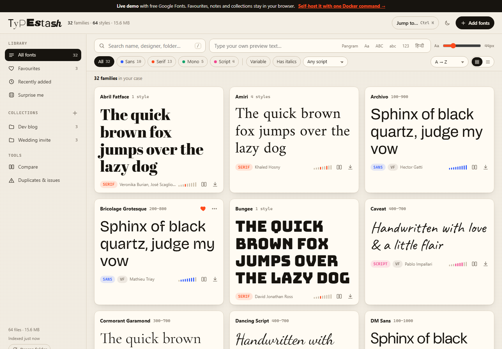
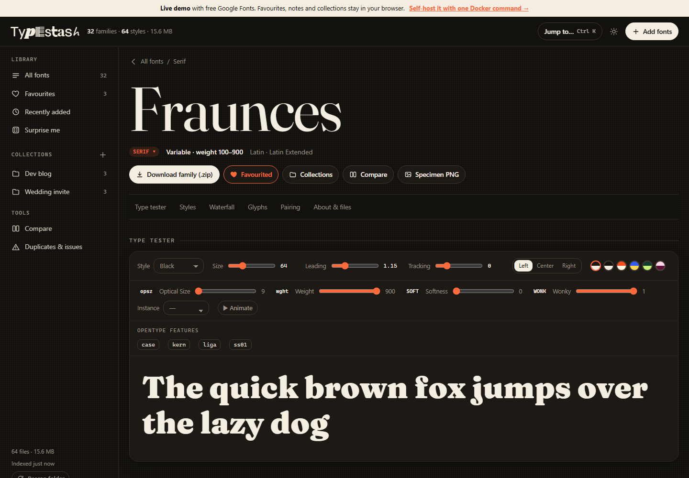

<p align="center"></p>

<h1 align="center">Typestash</h1>

<p align="center"><b>A self-hosted home for every font you own.</b><br>
Point it at a folder of fonts and get a searchable gallery with live previews,<br>
a proper type tester, glyph maps, collections and one-click downloads.</p>

<p align="center">
  <a href="https://jatinkrmalik.github.io/typestash/"><b>Live demo</b></a> ·
  <a href="#quick-start">Quick start</a> ·
  <a href="#configuration">Configuration</a> ·
  <a href="#reverse-proxy">Reverse proxy</a>
</p>



## Why

Fonts pile up: a zip from a client, a folder from an old laptop, that one typeface you
bought for a wedding invite. Desktop font managers only see one machine. Typestash
turns a folder on your NAS or server into a font library you can browse from any
browser, and download from whenever you need a font.

Your fonts stay plain files in a folder you choose. Typestash only reads them and
keeps a small index next to them, so Samba, rsync and your backups keep working.

## Features

- **Live gallery.** Every card is set in its own font. Type your own sample text,
  resize, switch grid/list. Hover a card to sweep through its weights.
- **Real metadata.** Reads family, style, weight, width, designer, foundry,
  version, license and language support from inside each font (not the file name).
- **Smart filters.** Sans, serif, mono, display, script; variable fonts; families
  with italics; script support (Latin, Cyrillic, Greek, Arabic, Hebrew, Devanagari,
  Bengali, Tamil, Thai, CJK, Hangul, Kana). Categories are detected automatically
  and you can override any of them.
- **Type tester.** Variable-font axis sliders (with an animate button), named
  instances, OpenType feature toggles (ligatures, small caps, figures, stylistic
  sets…), size, leading, tracking, alignment and colour themes.
- **Glyph map.** Every character in the font. Click to inspect, double-click to copy.
- **Waterfall, pairing and compare.** See a family at every size, try heading/body
  pairings with suggestions, and compare up to 8 fonts side by side.
- **Organise.** Favourites, collections (download a whole collection as a zip),
  and searchable notes per family.
- **Add fonts by dropping them.** Drag fonts or `.zip` archives anywhere on the
  page. Files are validated, de-duplicated by content and filed as
  `Uploads/<Family>/` in your fonts folder.
- **Download anything.** A single style, a whole family as a zip, or a PNG
  specimen sheet.
- **Housekeeping.** A duplicates & issues page lists identical files and fonts
  that could not be read. Nothing is ever deleted.
- **Command bar** (`Ctrl/⌘ K`), keyboard shortcuts (`/` search, `d` theme,
  `Esc` back), paper and ink themes, works on phones.
- Supports **TTF, OTF, WOFF, WOFF2, TTC/OTC** collections and zips.



## Quick start

```sh
mkdir typestash && cd typestash
mkdir fonts data
docker run -d --name typestash -p 8080:8080 \
  -v "$PWD/fonts:/fonts" -v "$PWD/data:/data" \
  -e PUID=$(id -u) -e PGID=$(id -g) \
  --restart unless-stopped \
  ghcr.io/jatinkrmalik/typestash:latest
```

Open <http://localhost:8080>, then drop some fonts on the page (or copy them into
`fonts/` and press **Rescan**).

### Docker Compose

```yaml
services:
  typestash:
    image: ghcr.io/jatinkrmalik/typestash:latest
    container_name: typestash
    restart: unless-stopped
    ports:
      - "8080:8080"
    volumes:
      - ./fonts:/fonts     # your font files
      - ./data:/data       # index, favourites, collections, notes
    environment:
      - PUID=1000
      - PGID=1000
      - TZ=Etc/UTC
      # - TYPESTASH_PASSWORD=change-me
```

The same file is in this repo as [`docker-compose.yml`](docker-compose.yml).
Images are built for `linux/amd64` and `linux/arm64` (Raspberry Pi 4/5, Apple
Silicon, ARM NAS boxes).

### Unraid

Use the template in [`templates/unraid/typestash.xml`](templates/unraid/typestash.xml)
(Docker tab → Add Container → Template). Defaults: fonts in `/mnt/user/fonts`,
app data in `/mnt/user/appdata/typestash`, PUID 99 / PGID 100.

### Without Docker

Python 3.11+:

```sh
pip install -r requirements.txt
TYPESTASH_FONTS=~/fonts TYPESTASH_DATA=~/.local/share/typestash python app/server.py
```

## Configuration

All settings are environment variables.

| Variable | Default | What it does |
|---|---|---|
| `PUID` / `PGID` | `1000` | User and group that own files Typestash writes (uploads, index). |
| `TYPESTASH_PASSWORD` | *(empty)* | Turns on HTTP basic auth. Leave empty when a reverse proxy handles login. |
| `TYPESTASH_USER` | `typestash` | Username for basic auth. |
| `TYPESTASH_UPLOADS` | `true` | `false` hides uploads and rejects them server-side (read-only library). |
| `TYPESTASH_UPLOAD_DIR` | `Uploads` | Sub-folder of the fonts folder that uploads are filed into. |
| `TYPESTASH_MAX_UPLOAD_MB` | `512` | Largest upload (a zip counts as one upload). |
| `TYPESTASH_RESCAN_SECONDS` | `600` | How often the fonts folder is checked for changes. |
| `TYPESTASH_FONTS` | `/fonts` | Fonts folder inside the container. |
| `TYPESTASH_DATA` | `/data` | Index and app data inside the container. |
| `TYPESTASH_PORT` | `8080` | Port inside the container. |

**What lives where**

- `/fonts`: your files, untouched except for new uploads under `Uploads/`.
- `/data/index.db`: SQLite with the font index, favourites, collections, notes and
  category overrides. Back this up if you care about your curation; the index
  itself rebuilds from the fonts folder.
- `/data/cache/`: faces extracted from `.ttc` collections for browser preview.
  Safe to delete.

## Reverse proxy

Typestash has no built-in TLS. Put it behind your usual proxy. It works at a
sub-path too (all URLs are relative).

**Caddy**

```caddy
fonts.example.com {
    reverse_proxy typestash:8080
    request_body {
        max_size 512MB
    }
}
```

**Traefik** (labels)

```yaml
labels:
  - traefik.enable=true
  - traefik.http.routers.typestash.rule=Host(`fonts.example.com`)
  - traefik.http.routers.typestash.entrypoints=websecure
  - traefik.http.routers.typestash.tls.certresolver=letsencrypt
  - traefik.http.services.typestash.loadbalancer.server.port=8080
```

**nginx**

```nginx
location / {
    proxy_pass http://typestash:8080;
    proxy_set_header Host $host;
    client_max_body_size 512m;
}
```

Want single sign-on? Put Authelia, Authentik or oauth2-proxy in front with
forward auth and leave `TYPESTASH_PASSWORD` empty.

## Font licensing

Typestash is a library for fonts **you are allowed to use**. It does not grant any
rights to the fonts in it. Each family page shows the license text embedded in the
font. Be careful about exposing commercial fonts to people outside your license.

## Development

```sh
docker compose -f docker-compose.dev.yml up --build   # live-edits app/
```

No build step: `app/server.py` (Python stdlib + [fontTools](https://github.com/fonttools/fonttools))
and `app/static/` (plain HTML, CSS and JavaScript).

The [live demo](https://jatinkrmalik.github.io/typestash/) is the same front end in
demo mode: `demo/build_demo.py` indexes free fonts from
[google/fonts](https://github.com/google/fonts) with the real server code and writes
a static snapshot. Build it locally with:

```sh
python demo/fetch_fonts.py demo/fonts.txt _fonts
python demo/build_demo.py _fonts _site
python -m http.server -d _site 8000
```

## License

[MIT](LICENSE). Demo fonts are from Google Fonts under the SIL Open Font License.
